# Bizarre Bites

Bizarre Bites è una piattaforma web che offre la possibilità, in qualità di ristoratore, di registrare il proprio
ristorante e iniziare a riceve ordini tramite la piattaforma.

## Indice

1. [Introduzione](#Introduzione)
    - [Login](#Login)
    - [Registrazione](#Registrazione)
    - [Lista dei ristoranti](#Lista-dei-ristoranti)
    - [Lista delle ricette](#Lista-delle-ricette)
2. [Ristoratore](#Ristoratore)
    - [Registrazione del ristorante](#Registrazione-del-ristorante)
    - [Gestione del ristorante](#Gestione-del-ristorante)
        - [Modifica dei dati del ristorante](#Modifica-dei-dati-del-ristorante)
3. [Cliente](#Cliente)

## Introduzione

La pagina principale del sito, `bizarre_bites.html`, si presenta come segue:

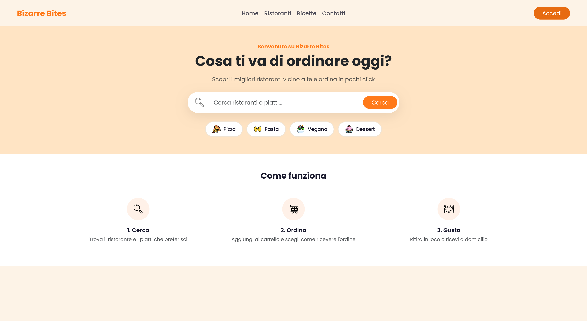

In questa pagina è possibile eseguire delle ricerche, dove però non è possibile eseguire un ordine (essendo necessario
essere registrati). Nella navbar ci sono collegamenti per accedere a varie pagine informative, come quella per
visualizzare l'intera selezione di ristoranti (`ristoranti.html`), le ricette (`ricette.html`) oppure per ottenere
assistenza (`contatti.html`). Inoltre è possibile accedere alla pagina di login.

### Login

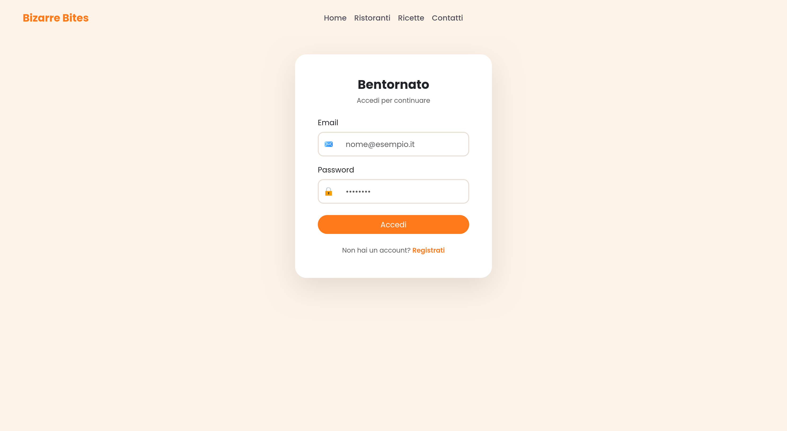

In questa pagina, `accesso.html` l'utente può eseguire l'accesso al proprio account inserendo la propria mail e
password. L'accesso avviene tramite l'API:

```
POST /user/login
```

In caso di inserimento errato, l'API restituirà un errore che verrà poi segnalato all'utente tramite l'apposito
messaggio:
<p align="center">
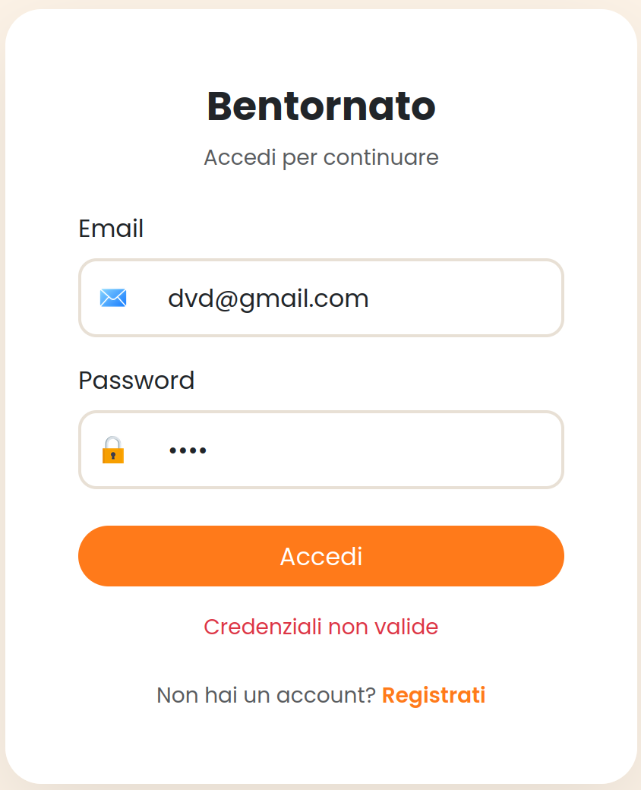
</p>

Una volta eseguito il login, i dati dell'utente vengono salvati in `localStorage`.

### Registrazione

Se l'utente non possiede un account, può registrarsi tramite l'apposito link posizionato sotto al tasto di accesso che
lo reinderizzerà nella pagina `registrazione.html`. La pagina si mostra come segue:

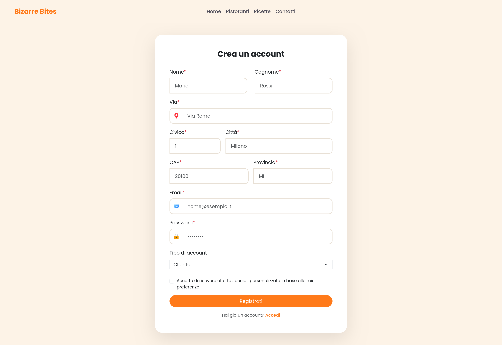

Si nota che, in fase di registrazione, l'utente può scegliere se registrarsi come cliente o come ristoratore. Nel primo
caso gli viene anche chiesto se vuole ricevere offerte speciali personalizzate. Quando si seleziona un ristoratore,
l'opzione scompare:

<p align="center">
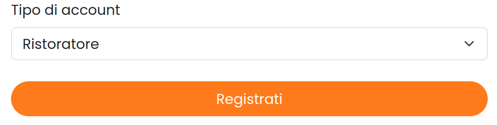
</p>

La registrazione avviene tramite l'API:

```
POST /user/register
```

Bisogna notare che, nell'API si verifica che l'indirizzo sia veramente esistente, tramite API di OpenStreetMap, al fine
di ottenere un corretto calcolo di percorso di consegna tra il ristorante e il cliente (NON IMPLEMENTATO). In caso di
errore l'utente riceverà un messaggio di errore.

Caso indirizzo non valido:
<p align="center">
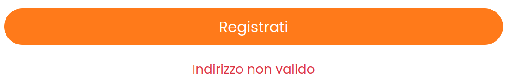
</p>

Caso inserimento errato di un campo:
<p align="center">

</p>

Una volta avvenuta la registrazione, se l'utente è di tipo ristoratore viene reindirizzato alla pagina di gestione del
ristorante, in cui potrà poi registrarne uno. In caso contrario viene indirizzato alla homepage.

A registrazione avvenuta, i dati dell'utente vengono salvati in `localStorage`.

### Lista dei ristoranti

In `ristoranti.html` è possibile visualizzare la lista completa dei ristoranti:

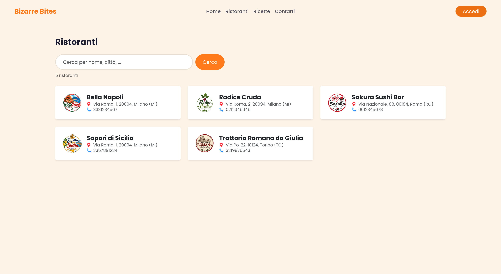

I ristoranti vengono ottenuti tramite l'API:

```
GET /ristoranti
```

Questa API restituisce tutti i ristoranti registrati nel ne DB, che vengono salvati in un array. La ricerca è
implementata lato client, filtrando l'array in memoria.

### Lista delle ricette

È possibile visualizzare le ricette tramite la pagina `ricette.html`:

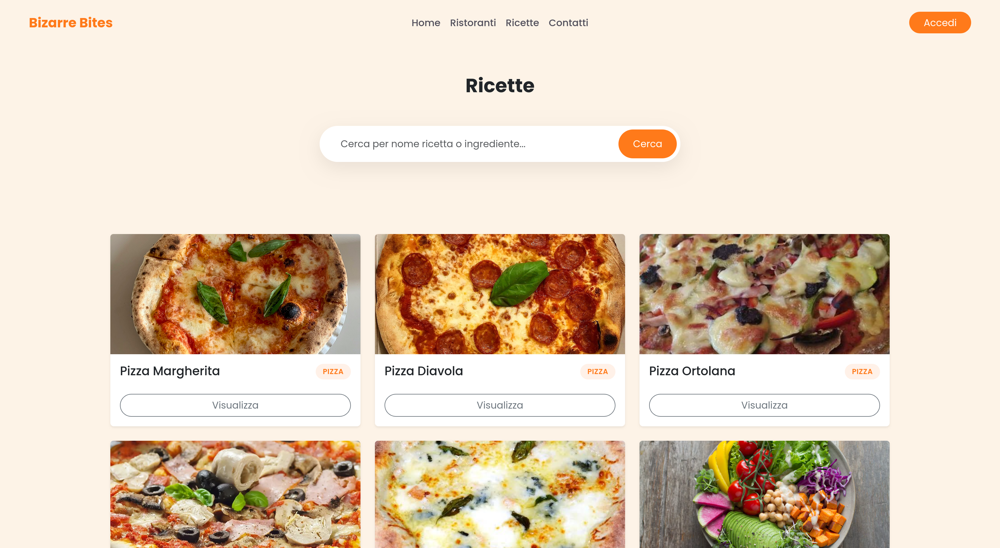

Le ricette vengono ottenute tramite l'API:

```
GET /ricette
```

L'API restituisce tutte le ricette registrate nel ne DB, che vengono poi salvate in un array. La ricerca è implementata
lato client, filtrando l'array in memoria.

## Ristoratore

Un ristoratore accede tramite le credenziali create in fase di registrazione. Ad accesso eseguito, verrà reindirizzato
alla pagina di gestione, `gestione_ristorante.html`, in cui viene recuperato il ristorante a esso associato tramite
l'API:

```
GET /user/:id/ristorante
```

Se al ristoratore è associato un ristorante, esso viene salvato in `localStorage`.

### Registrazione del ristorante

Se a un ristoratore non è ancora associato un ristorante, nella pagina di gestione visualizzerà un messaggio che gli
permette di fare ciò.

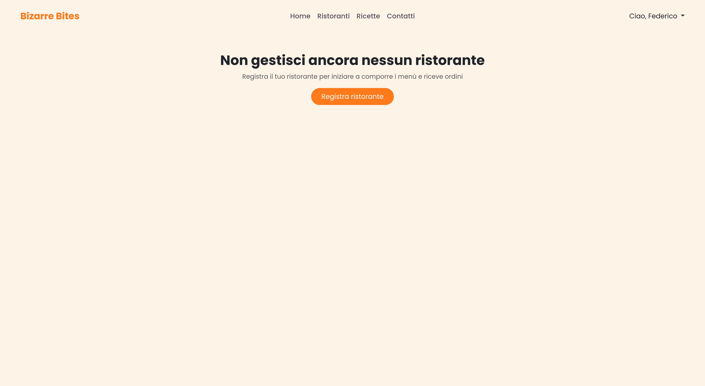

Esso verrà reindirizzato alla pagina `ristorante/registrazione_ristorante.html`.


La registrazione del ristorante avviene tramite l'API:

```
POST /user/:id/ristorante
```

Anche qui viene verificato che l'indirizzo sia valido tramite le API di OpenStreetMap. In caso di errore, l'utente
riceverà un messaggio di errore. Inoltre, nel DB è stato implementato un vincolo di unicità sulla partita IVA, quindi se
un ristoratore prova a registrare un ristorante con una partita IVA già presente nel DB, riceverà un messaggio di
errore.

Avvenuta la registrazione, il ristorante viene salvato in `localStorage`.

### Gestione del ristorante

Quando a un ristoratore è associato un ristorante, in `ristorante/gestione_ristorante.html` l'utente visualizzerà tutte
le possibili operazioni che può eseguire sul ristorante:

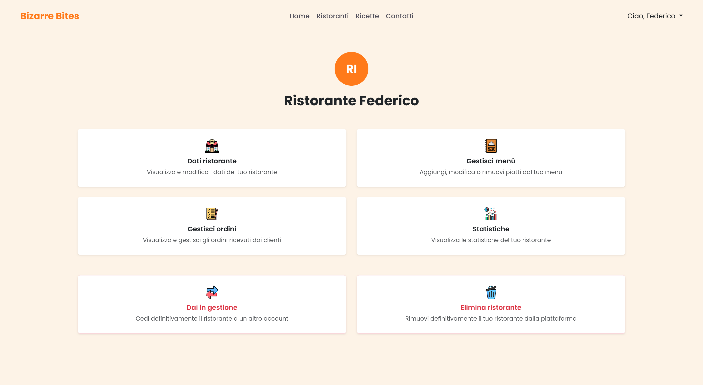

#### Modifica dei dati del ristorante

Cliccando su "Dati ristorante" l'utente viene reindirizzato alla pagina `ristorante/dati_ristorante.html`, in cui può
modificare i dati del ristorante.

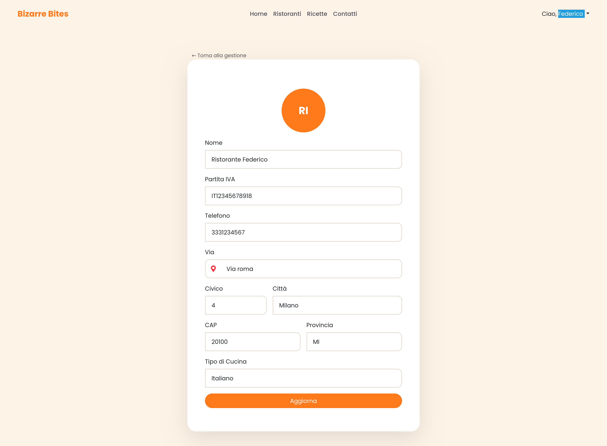

La modifica dei dati avviene tramite l'API:

```
PUT /user/:id/ristorante
```

Anche qui verranno effettuati i controlli di correttezza dei dati e segnalati all'utente se questi errati.

Da questa pagina l'utente può anche modificare il logo, cliccandoci sopra. Si aprirà un modal in cui inserire il link
dell'immagine (utilizzando un servizio di hosting come imgBB). Una volta inserito il link, comparirà un'anteprima. In
caso di errore, l'utente verrà avvisato tramite l'apposito messaggio.

<p align="center">
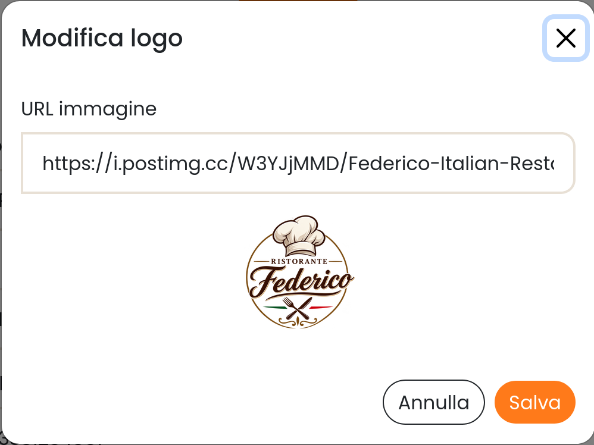
</p>

Il caricamento dell'immagine avviene tramite l'API:

```
PUT /user/:id/ristorante/logo
```

Il logo può essere rimosso dallo stesso modal, cliccando sul link "Rimuovi logo attuale". Lato backend, viene utilizzata
la stessa API, ma passandogli logoUrl impostato a `null`.

In caso il ristorante non abbia un logo, verrà visualizzato un placeholder con le prime 2 lettere del nome.

#### Gestione del menù

Cliccando su "Gestisci menù" l'utente viene reindirizzato alla pagina `ristorante/gestione_menu.html`, in cui può
visualizzare il menù, inserire o rimuovere piatti.

All'apertura della pagina, il menù viene caricato tramite l'API:

```
GET /ristorante/:id/menu
```

Nel caso il menù sia vuoto, l'utente visualizzerà la seguente schermata:

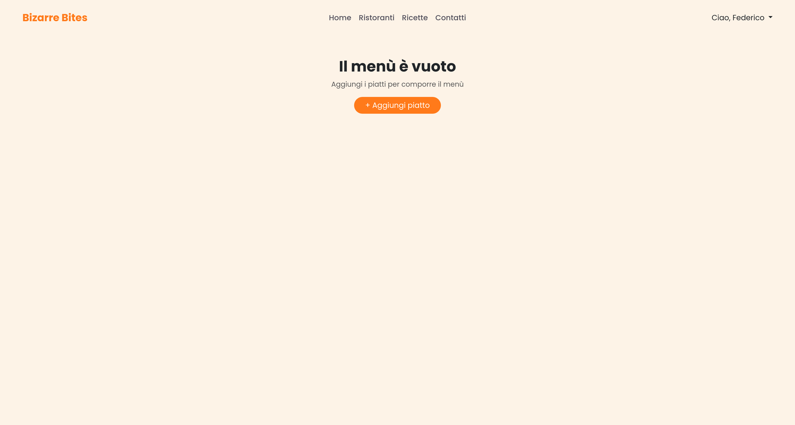

Cliccando il bottone si aprirà un modal. Da questo modal si può scegliere di inserire un piatto esistente dal catalogo
fornito dalla piattaforma (i piatti contenuti in meals.json) oppure di inserire un piatto personalizzato.

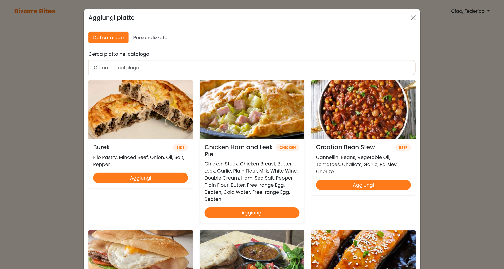

Il catalogo è caricato dal DB tramite l'API:

```
GET /piatti
```