# Bizarre Bites

Bizarre Bites è una piattaforma web che offre la possibilità, in qualità di ristoratore, di registrare il proprio
ristorante e iniziare a riceve ordini tramite la piattaforma.

## Indice

1. [Introduzione](#Introduzione)
    - [Login](#Login)
    - [Registrazione](#Registrazione)
    - [Gestione account](#Gestione-account)
    - [Lista dei ristoranti](#Lista-dei-ristoranti)
    - [Lista delle ricette](#Lista-delle-ricette)
2. [Ristoratore](#Ristoratore)
    - [Registrazione del ristorante](#Registrazione-del-ristorante)
    - [Gestione del ristorante](#Gestione-del-ristorante)
        - [Modifica dei dati del ristorante](#Modifica-dei-dati-del-ristorante)
        - [Gestione del menù](#Gestione-del-menù)
        - [Gestione ordini](#Gestione-ordini)
        - [Statistiche](#Statistiche)
    - [Cessione del ristorante](#Cessione-del-ristorante)
    - [Eliminazione del ristorante](#Eliminazione-del-ristorante)
3. [Cliente](#Cliente)
    - [Ricerca](#Ricerca)
    - [Ordinare](#Ordinare)

## Introduzione

La pagina principale del sito, `bizarre_bites.html`, si presenta come segue:

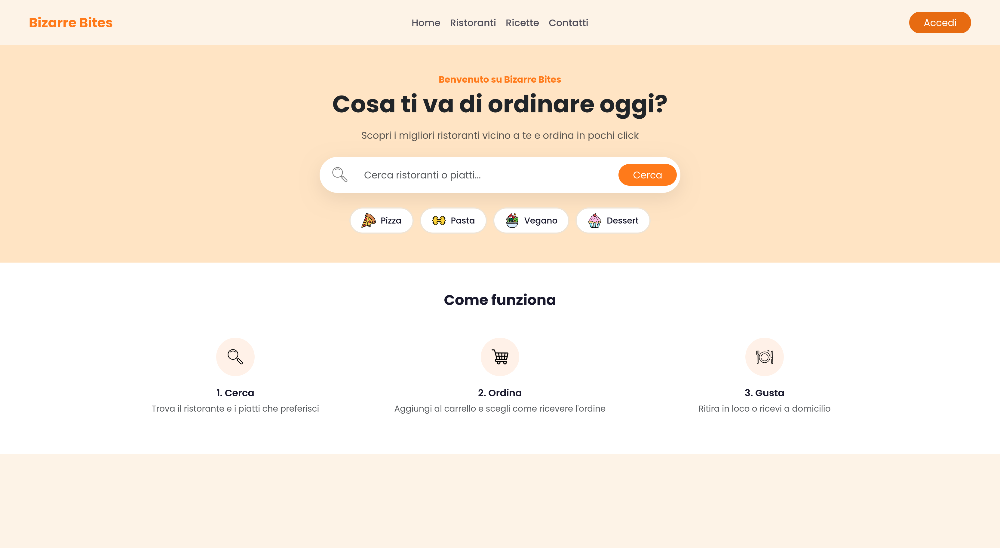

In questa pagina è possibile eseguire delle ricerche, dove però non è possibile eseguire un ordine (essendo necessario
essere registrati). Nella navbar ci sono collegamenti per accedere a varie pagine informative, come quella per
visualizzare l'intera selezione di ristoranti (`ristoranti.html`), le ricette (`ricette.html`) oppure per ottenere
assistenza (`contatti.html`). Inoltre è possibile accedere alla pagina di login.

### Login

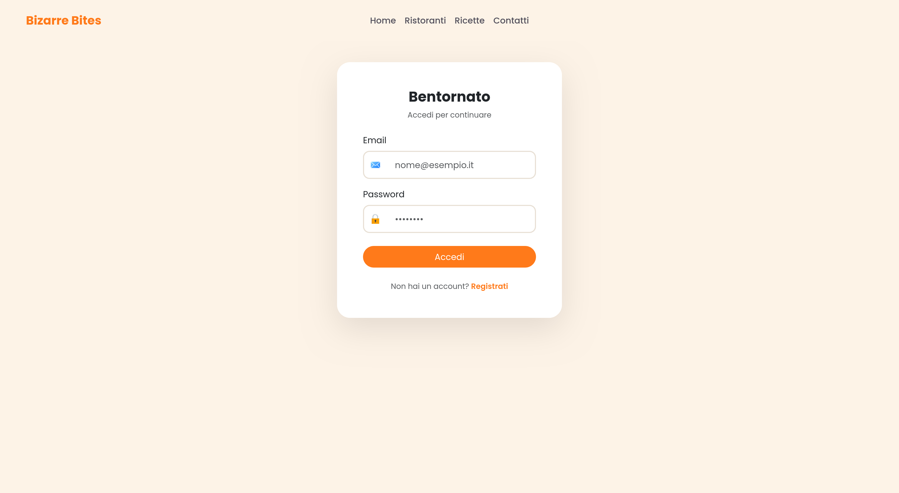

In questa pagina, `accesso.html` l'utente può eseguire l'accesso al proprio account inserendo la propria mail e
password. L'accesso avviene tramite l'API:

```
POST /user/login
```

In caso di inserimento errato, l'API restituirà un errore che verrà poi segnalato all'utente tramite l'apposito
messaggio:
<p align="center">
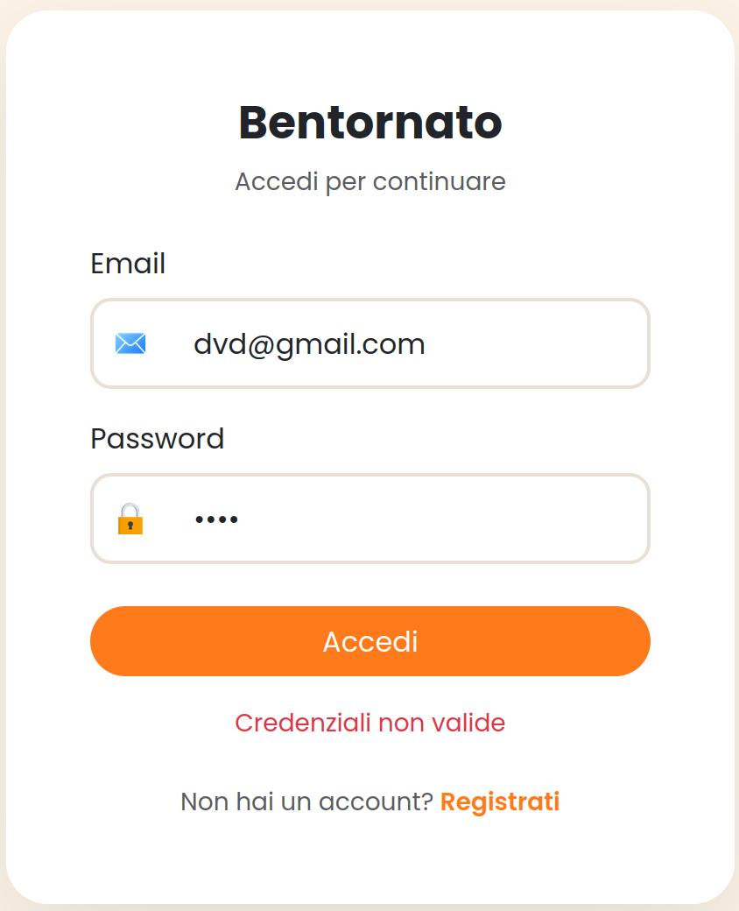
</p>

Una volta eseguito il login, i dati dell'utente vengono salvati in `localStorage`.

### Registrazione

Se l'utente non possiede un account, può registrarsi tramite l'apposito link posizionato sotto al tasto di accesso che
lo reinderizzerà nella pagina `registrazione.html`. La pagina si mostra come segue:

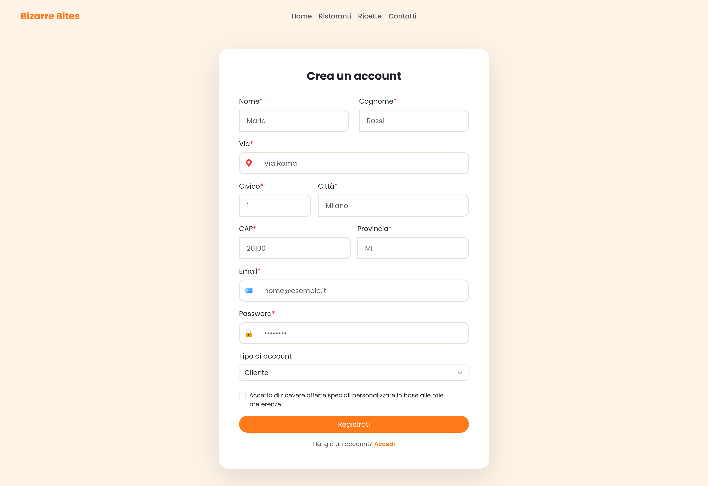

Si nota che, in fase di registrazione, l'utente può scegliere se registrarsi come cliente o come ristoratore. Nel primo
caso gli viene anche chiesto se vuole ricevere offerte speciali personalizzate. Quando si seleziona un ristoratore,
l'opzione scompare:

<p align="center">
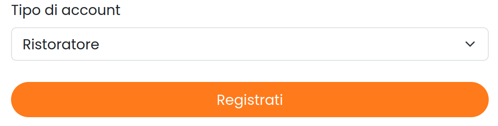
</p>

La registrazione avviene tramite l'API:

```
POST /user/register
```

Bisogna notare che, nell'API si verifica che l'indirizzo sia veramente esistente, tramite API di OpenStreetMap, al fine
di ottenere un corretto calcolo di percorso di consegna tra il ristorante e il cliente (NON IMPLEMENTATO). In caso di
errore l'utente riceverà un messaggio di errore.

Caso indirizzo non valido:
<p align="center">
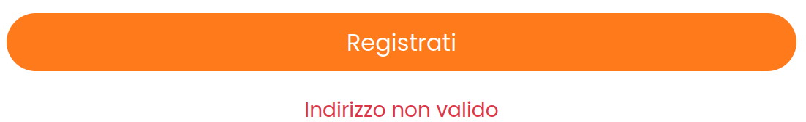
</p>

Caso inserimento errato di un campo:
<p align="center">
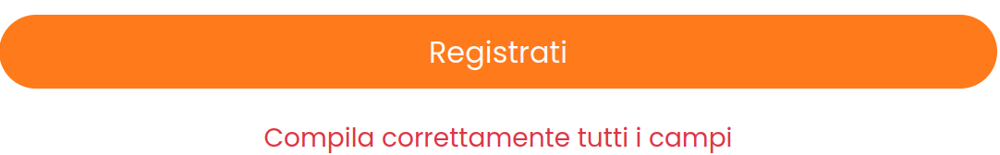
</p>

Una volta avvenuta la registrazione, se l'utente è di tipo ristoratore viene reindirizzato alla pagina di gestione del
ristorante, in cui potrà poi registrarne uno. In caso contrario viene indirizzato alla homepage.

A registrazione avvenuta, i dati dell'utente vengono salvati in `localStorage`.

### Gestione account

L'utente può gestire le informazioni del proprio account cliccando il menù a tendina presente nella navbar, cliccando
sul proprio nome e selezionando l'opzione "Modifica profilo".

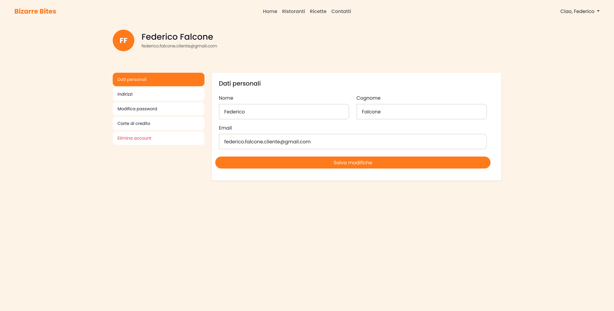

Sono presenti 4 opzioni:

- Modifica dei dati personali come nome, cognome, mail. Le modifiche sono salvate nel DB tramite l'API:

```
PUT /user/id
```

- Gestire gli indirizzi in cui l'utente puà aggiungere e rimuovere indirizzi. Nota che un utente non può non avere
  indirizzi salvati.

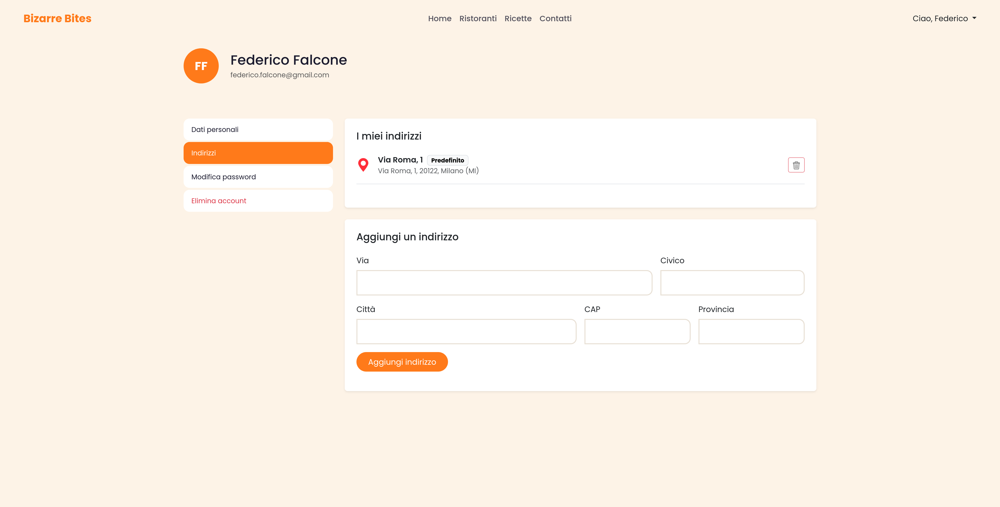

L'inserimento di un nuovo indirizzo avviene tramite l'API:

```
POST /user/:id/indirizzi
```

L'eliminazione di un indirizzo avviene tramite l'API:

```
DELETE /user/:id/indirizzi/:id_indirizzo
```

- Modifica della password.

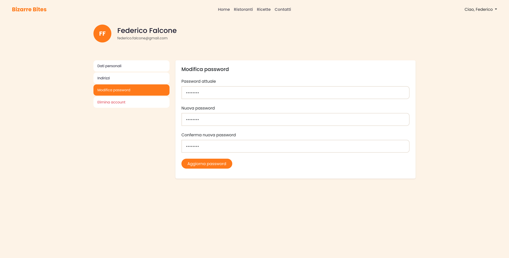

La modifica della password avviene tramite l'API, in cui viene verificata che la vecchia password sia inserita
correttamente:

```
PUT /user/:id/password
```

La ripetizione della nuova password viene verificata lato client.

- Gestione delle carte di pagamento, in cui l'utente può aggiungere o rimuovere carte di pagamento.

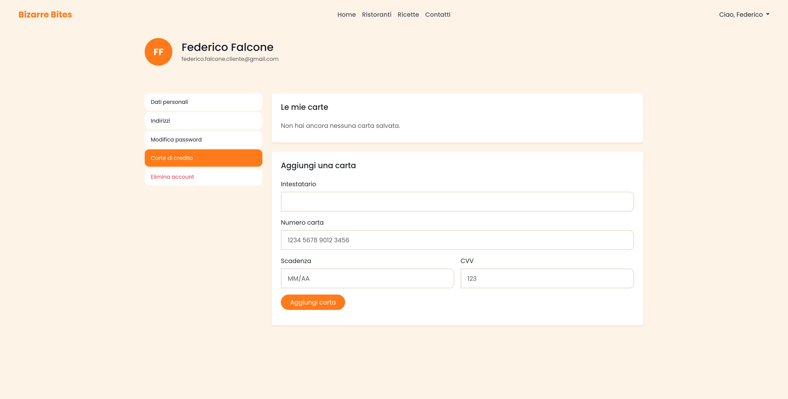

Al caricamento della pagina vengono caricate le carte tramite l'API:

```
GET /user/:id/carte-pagamento
```

L'inserimento di una nuova carta avviene tramite l'API:

```
POST /user/:id/carte-pagamento
```

L'eliminazione di una carta avviene tramite l'API:

```
DELETE /user/:id/carte-pagamento/:id_carta
```

- Eliminazione dell'account. Un utente ristoratore non può eliminare il proprio account se gestisce un ristorante.
  Avviene tramite l'API:

```
DELETE /user/:id
```

### Lista dei ristoranti

In `ristoranti.html` è possibile visualizzare la lista completa dei ristoranti:

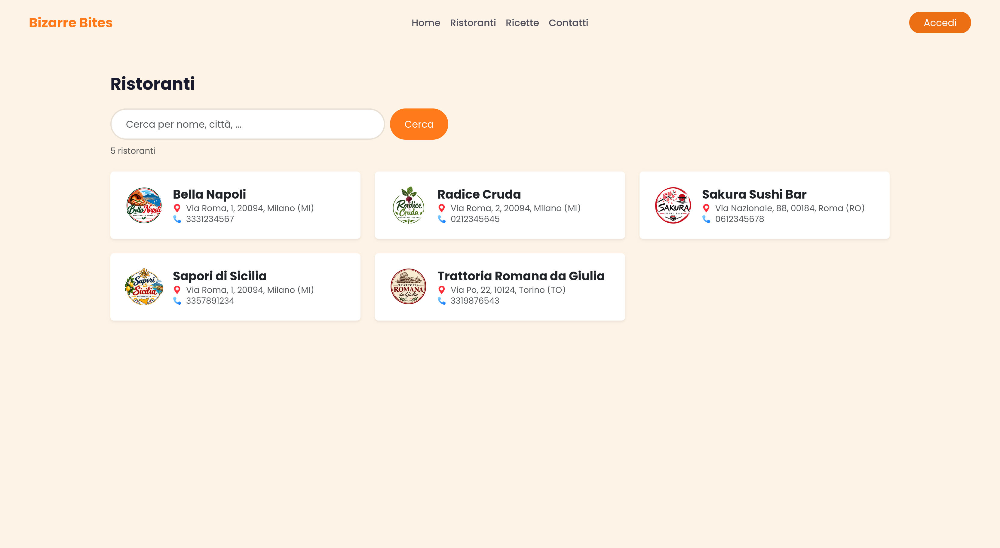

I ristoranti vengono ottenuti tramite l'API:

```
GET /ristoranti
```

Questa API restituisce tutti i ristoranti registrati nel ne DB, che vengono salvati in un array. La ricerca è
implementata lato client, filtrando l'array in memoria.

### Lista delle ricette

È possibile visualizzare le ricette tramite la pagina `ricette.html`:

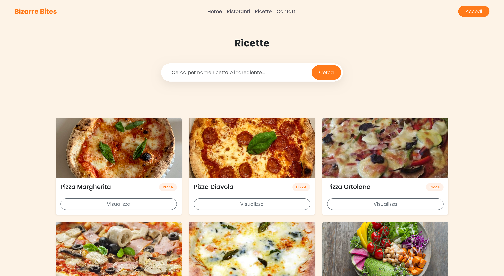

Le ricette vengono ottenute tramite l'API:

```
GET /ricette
```

L'API restituisce tutte le ricette registrate nel ne DB, che vengono poi salvate in un array. La ricerca è implementata
lato client, filtrando l'array in memoria.

## Ristoratore

Un ristoratore accede tramite le credenziali create in fase di registrazione. Ad accesso eseguito, verrà reindirizzato
alla pagina di gestione, `gestione_ristorante.html`, in cui viene recuperato il ristorante a esso associato tramite
l'API:

```
GET /user/:userId/ristorante
```

Se al ristoratore è associato un ristorante, esso viene salvato in `localStorage`.

### Registrazione del ristorante

Se a un ristoratore non è ancora associato un ristorante, nella pagina di gestione visualizzerà un messaggio che gli
permette di fare ciò.

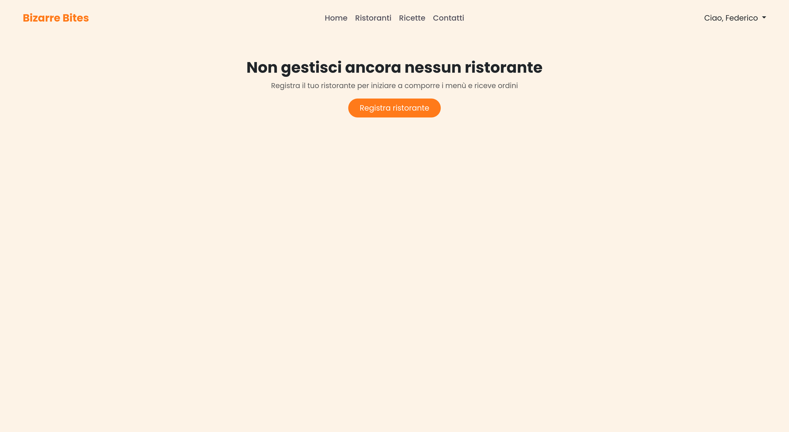

Esso verrà reindirizzato alla pagina `ristorante/registrazione_ristorante.html`.


La registrazione del ristorante avviene tramite l'API:

```
POST /user/:userId/ristorante
```

Anche qui viene verificato che l'indirizzo sia valido tramite le API di OpenStreetMap. In caso di errore, l'utente
riceverà un messaggio di errore. Inoltre, nel DB è stato implementato un vincolo di unicità sulla partita IVA, quindi se
un ristoratore prova a registrare un ristorante con una partita IVA già presente nel DB, riceverà un messaggio di
errore.

Avvenuta la registrazione, il ristorante viene salvato in `localStorage`.

### Gestione del ristorante

Quando a un ristoratore è associato un ristorante, in `ristorante/gestione_ristorante.html` l'utente visualizzerà tutte
le possibili operazioni che può eseguire sul ristorante:

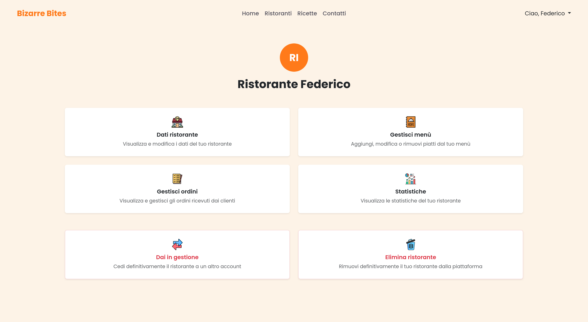

#### Modifica dei dati del ristorante

Cliccando su "Dati ristorante" l'utente viene reindirizzato alla pagina `ristorante/dati_ristorante.html`, in cui può
modificare i dati del ristorante.

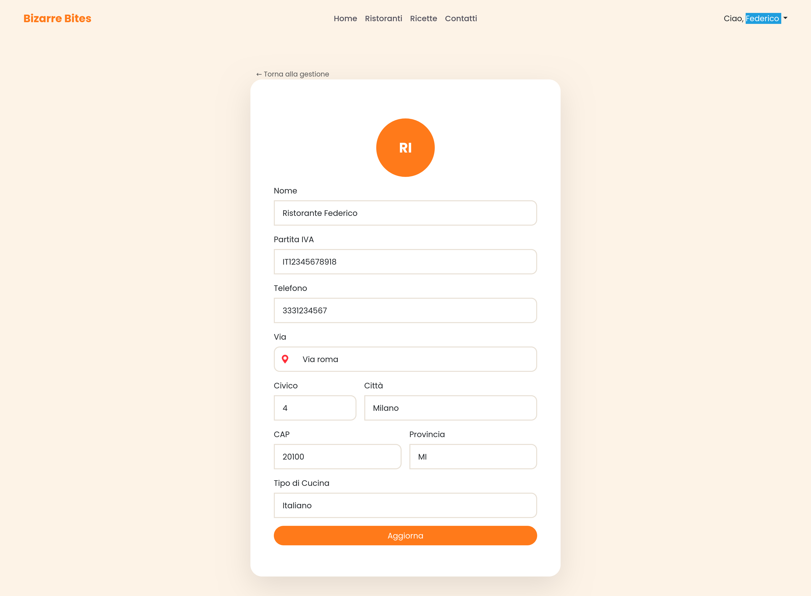

La modifica dei dati avviene tramite l'API:

```
PUT /user/:userId/ristorante
```

Anche qui verranno effettuati i controlli di correttezza dei dati e segnalati all'utente se questi errati.

Da questa pagina l'utente può anche modificare il logo, cliccandoci sopra. Si aprirà un modal in cui inserire il link
dell'immagine (utilizzando un servizio di hosting come imgBB). Una volta inserito il link, comparirà un'anteprima. In
caso di errore, l'utente verrà avvisato tramite l'apposito messaggio.

<p align="center">
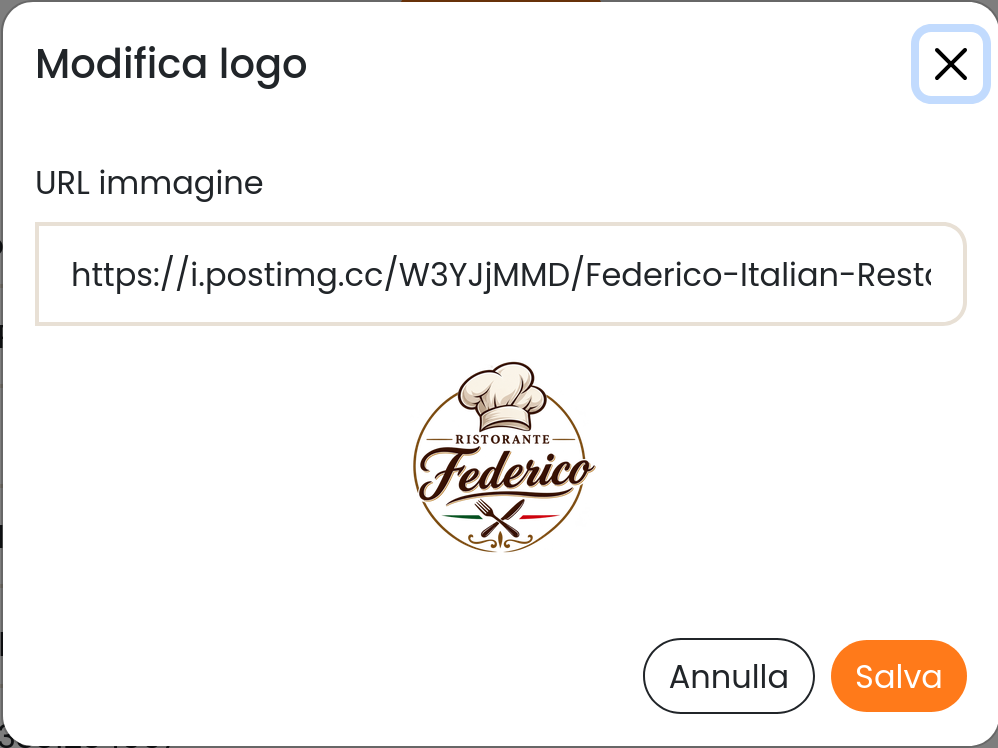
</p>

Il caricamento dell'immagine avviene tramite l'API:

```
PUT /user/:userId/ristorante/logo
```

Il logo può essere rimosso dallo stesso modal, cliccando sul link "Rimuovi logo attuale". Lato backend, viene utilizzata
la stessa API, ma passandogli logoUrl impostato a `null`.

In caso il ristorante non abbia un logo, verrà visualizzato un placeholder con le prime 2 lettere del nome.

#### Gestione del menù

Cliccando su "Gestisci menù" l'utente viene reindirizzato alla pagina `ristorante/gestione_menu.html`, in cui può
visualizzare il menù, inserire o rimuovere piatti.

All'apertura della pagina, il menù viene caricato tramite l'API:

```
GET /ristorante/:userId/menu
```

Nel caso il menù sia vuoto, l'utente visualizzerà la seguente schermata:

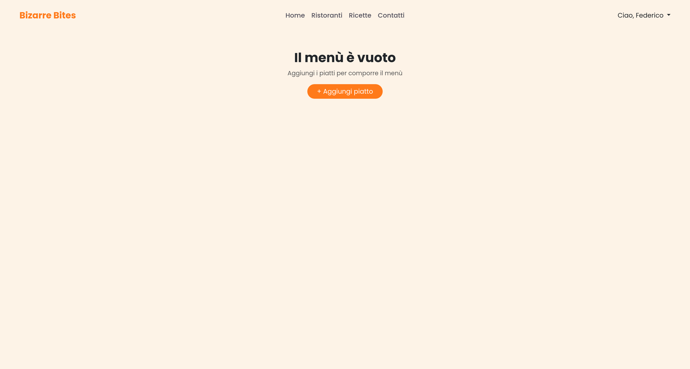

Cliccando il bottone si aprirà un modal. Da questo modal si può scegliere di inserire un piatto esistente dal catalogo
fornito dalla piattaforma (i piatti contenuti in meals.json) oppure di inserire un piatto personalizzato.

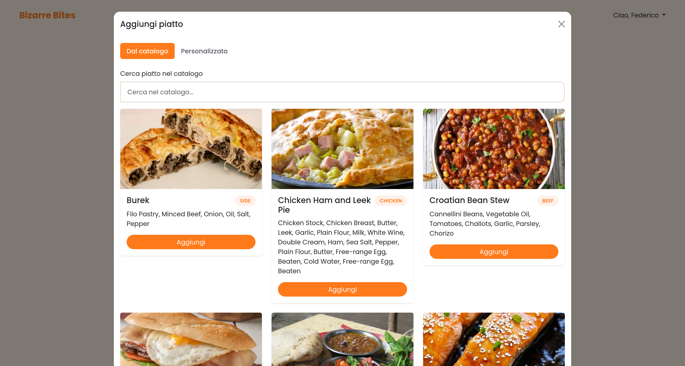

Il catalogo è caricato dal DB tramite l'API:

```
GET /piatti
```

Una volta selezionato il piatto, si aprirà un altro modal in cui inserire il prezzo del piatto.

<p align="center">
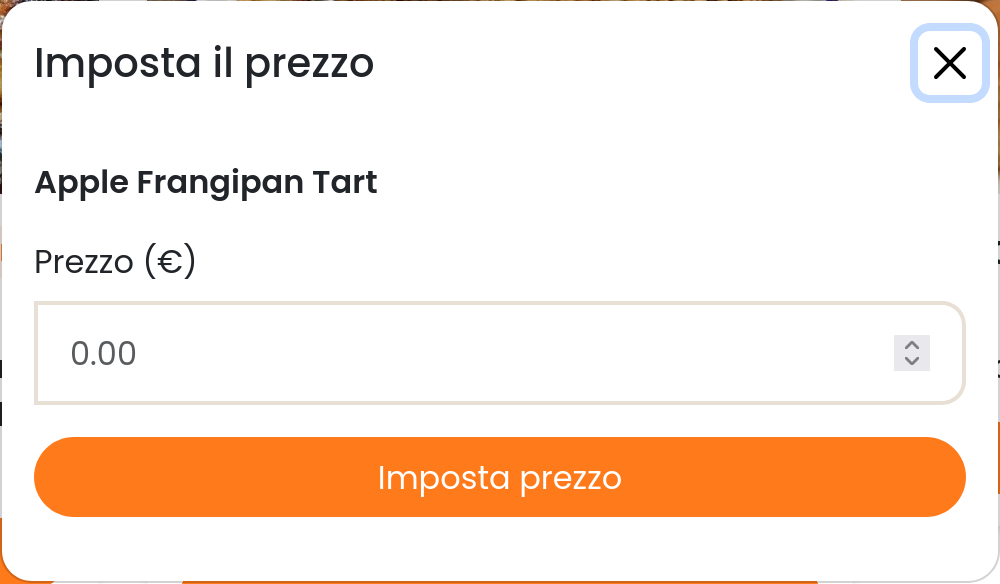
</p>

Una volta impostato il prezzo, il piatto viene aggiunto al menù tramite l'API:

```
POST /ristorante/:userId/menu/catalogo
```

Se si vuole inserire un piatto personalizzato, nel modal di aggiunta piatto c'è la scheda apposita:

<p align="center">
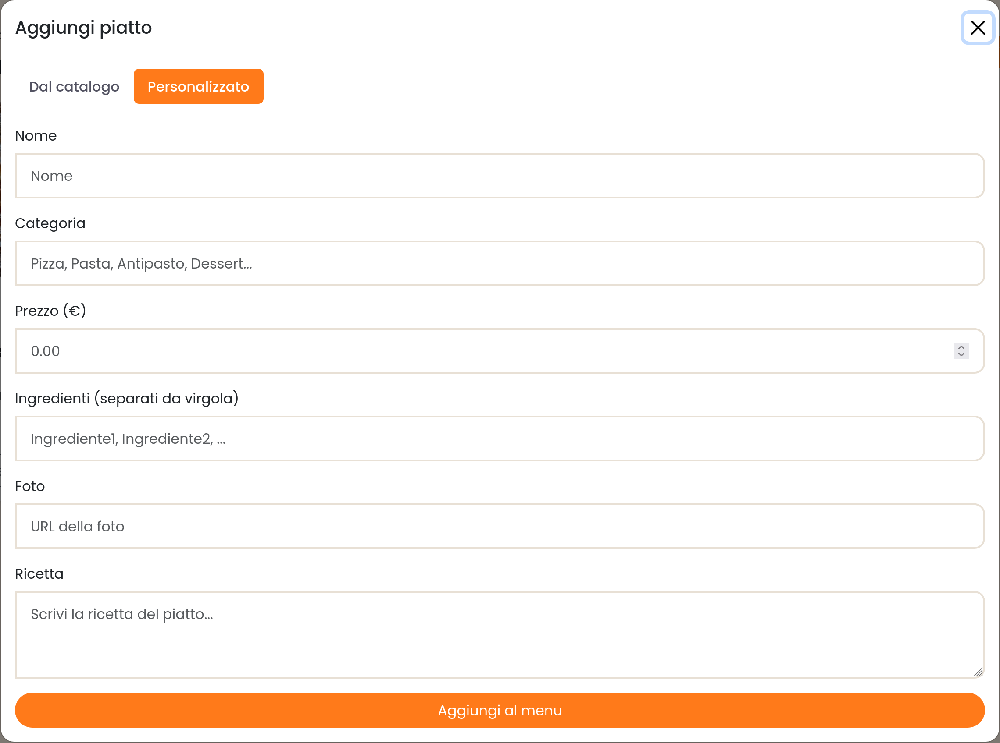
</p>

L'inserimento dei dati è controllato a lato client. C'è inoltre il controllo se l'immagine inserita sia valida.

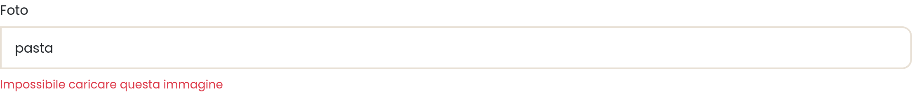

Se non si inserisce nessuna immagine, verrà salvato un placeholder.

L'inserimento del piatto personalizzato avviene tramite l'API:

```
POST /ristorante/:userId/menu/personalizzato
```

Una volta popolato, il menù si presenta nel seguente modo:

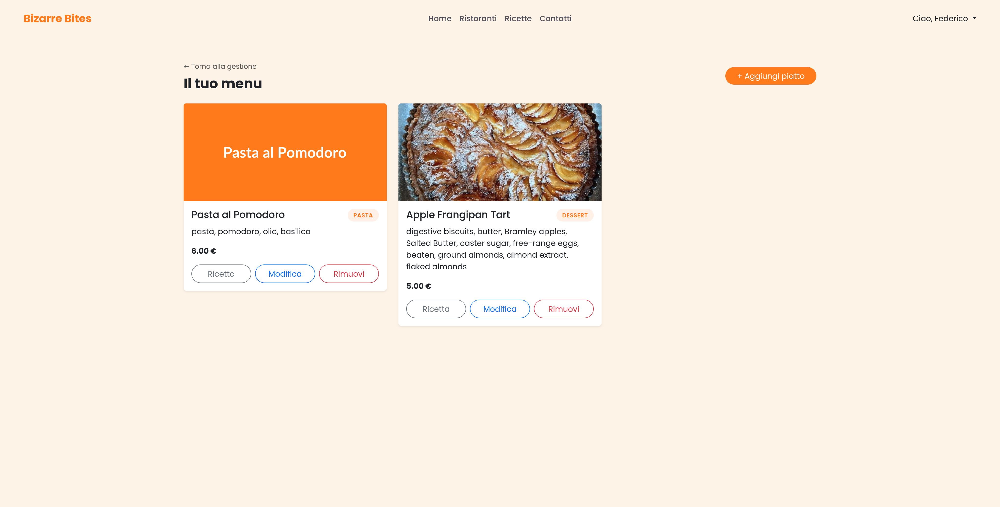

È prevista la gestione del singolo piatto, ovvero è possibile:

- Visualizzare la ricetta: cliccando sull'apposito bottone si aprirà un modal con la ricetta.
- Modificare il piatto: cliccando sull'apposito bottone si aprirà un modal in cui modificare le informazioni del piatto.
  La modifica avviene tramite l'API:

```
PUT /ristorante/:userId/menu/:id_prodotto
```

<p align="center">
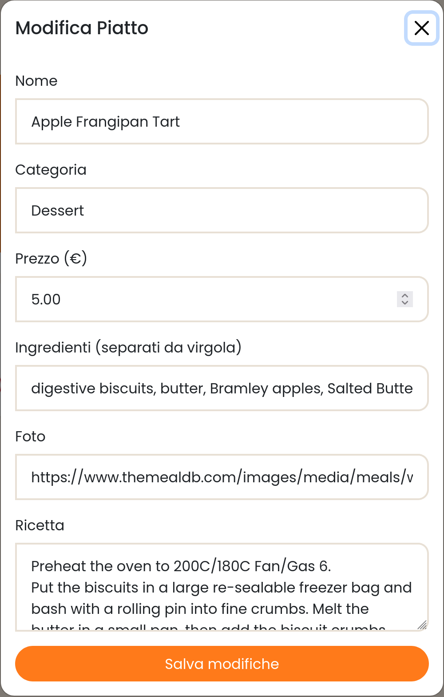
</p>

- Rimuovere il piatto dal menu: cliccando sull'apposito bottone, il piatto verrà rimosso tramite l'API:

```
DELETE /ristorante/:userId/menu
```

#### Gestione ordini

Cliccando su "Gestisci ordini" l'utente viene reindirizzato alla pagina `ristorante/gestione_ordini.html`, in cui può
visualizzare tutti gli ordini ricevuti.

All'apertura della pagina vengono caricati tutti gli ordini tramite l'API:

```
GET /user/:userId/ristorante/ordini
```

La pagina che si apre si presenta come segue:

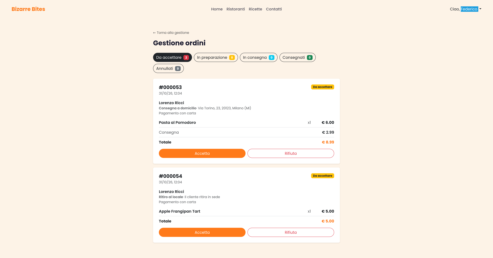

La pagina ha 5 bottoni che permettono di filtrare gli ordini in base al loro stato.

- Gli ordini appena eseguiti entrano nello stato di "Accettazione". Il ristoratore dovrà decidere se accettare l'ordine
  oppure rifiutarlo. Nel primo caso, l'ordine passerà nello stato di "Preparazione", mentre nel secondo caso verrà
  rifiutato e messo nello stato di "Annullato".

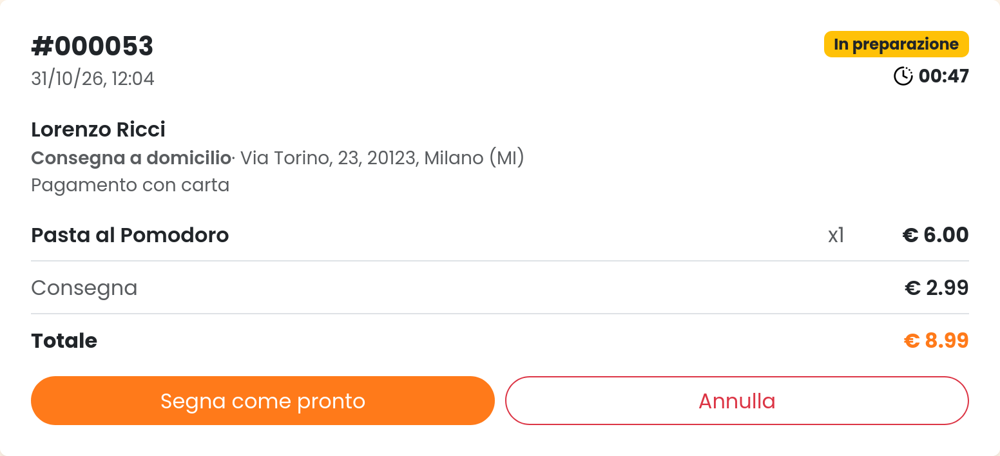

- Una volta che l'ordine viene accettato, esso entra nello stato di "Preparazione". Il ristoratore, in questo stato, può
  visualizzare il tempo di preparazione dall'accettazione. Una volta che l'ordine è pronto, il ristoratore lo segnala
  come tale tramite l'apposito bottone. In caso esso cambi idea, può annullare l'ordine.
- Se l'utente cliente ha scelto la consegna a domicilio, una volta pronto, l'ordine entrerà nello stato di "Consegna".
  Sarà poi lui a segnalare l'avvenuta consegna. Se invece ha scelto di ritirare al locale, l'ordine entrerà direttamente
  nello stato finale, "Consegnato".

Il passaggio di stato avviene tramite l'API:

```
PUT /user/:userId/ristorante/ordini/:numeroOrdine/stato/aggiorna
```

L'annullamento dell'ordine avviene tramite l'API:

```
PUT /user/:userId/ristorante/ordini/:numeroOrdine/stato/annulla
```

#### Statistiche

Cliccando su "Statistiche" l'utente viene reindirizzato alla pagina `ristorante/statistiche.html`, in cui può
visualizzare le statistiche del proprio ristorante. Qui può visualizzare l'incasso annuale, lo scontrino medio, il tempo
di preparazione medio, il numero totale di ordini e i piatti più venduti.

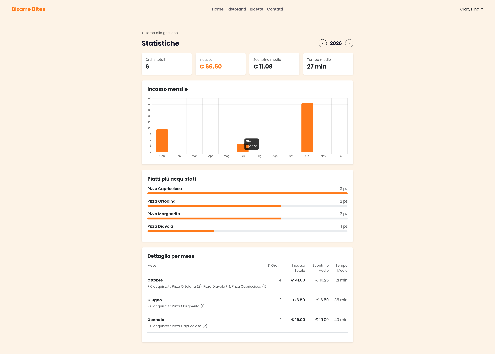

I dati vengono caricati tramite l'API:

```
GET /user/:userId/ristorante/statistiche
```

### Cessione del ristorante

Un ristoratore può decidere di cedere il proprio ristorante a un altro ristoratore registrato, ma che sia "libero",
ovvero che non gestisca già un ristorante. Per fare ciò, nella bacheca di gestione del ristorante, cliccando su "Dai in
gestione" si aprirà un modal in cui inserire la mail del nuovo gestore.

<p align="center">
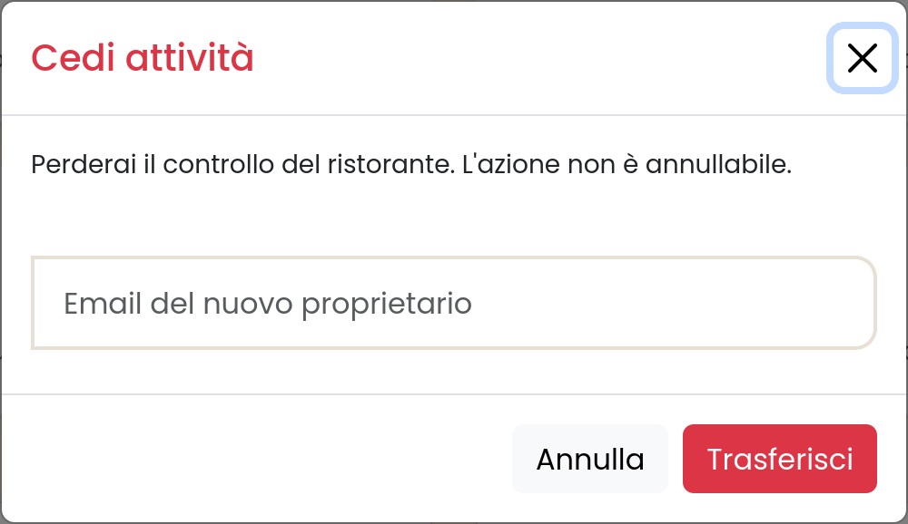
</p>

La cessione avviene tramite l'API:

```
POST /ristorante/:userId/trasferisci
```

Una volta confermata la cessione, il ristoratore non avrà più accesso al ristorante.

### Eliminazione del ristorante

Un ristoratore può eliminare il proprio ristorante, tramite l'apposita opzione nella bacheca di gestione. Cliccando su
"Elimina ristorante" si aprirà un modal in cui confermare l'eliminazione.

L'eliminazione avviene tramite l'API:

```
DELETE /user/:userId/ristorante
```

# Cliente

Un cliente accede tramite le credenziali create in fase di registrazione. Ad accesso eseguito, verrà reindirizzato alla
homage, `bizarre_bites.html`.

## Ricerca

Dalla homepage l'utente può eseguire la ricerca. Essa avviene pere categoria, per nome piatto, per città o per nome
ristorante. La ricerca reindirizza alla pagina `search.htlml` a cui passa i parametri parametric di ricerca nell'URL.

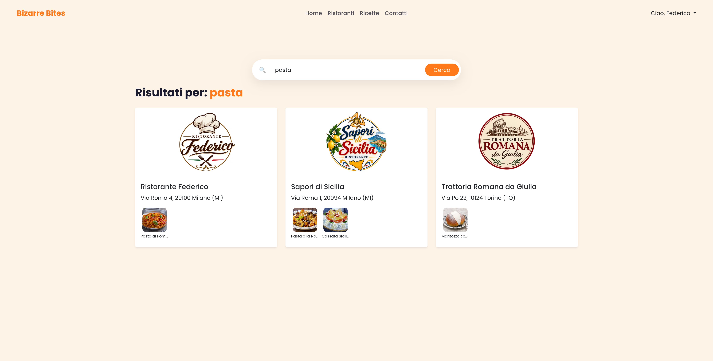

Quando si ricerca un piatto o una categoria, sotto ai risultati dei ristoranti vengono visualizzati anche i piatti
ottenuti.

Cosa che non avviene se ricerchiamo un ristorante:

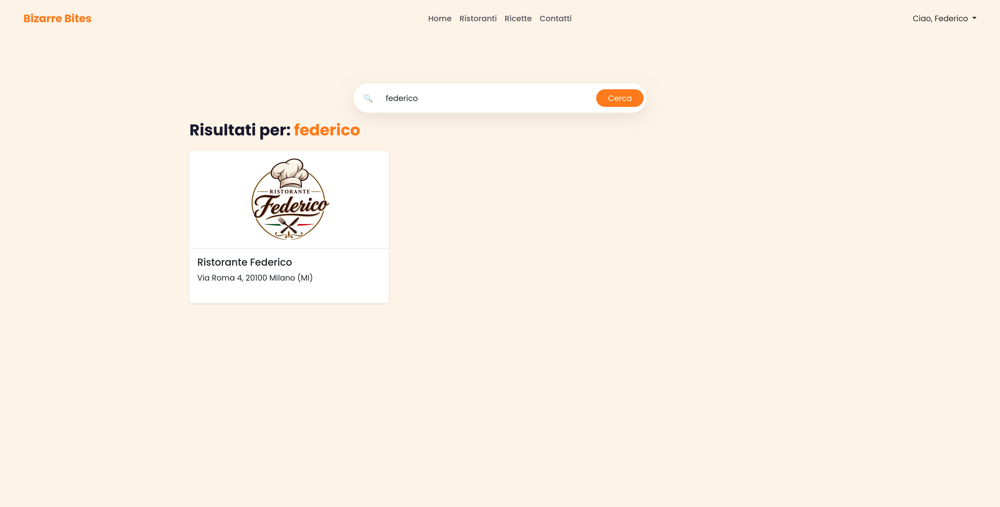

La ricerca avviene tramite l'API:

```
GET /search/:query
```

Cliccando su un ristorante, si visualizzerà il menù nella pagina `ristorante.html`.

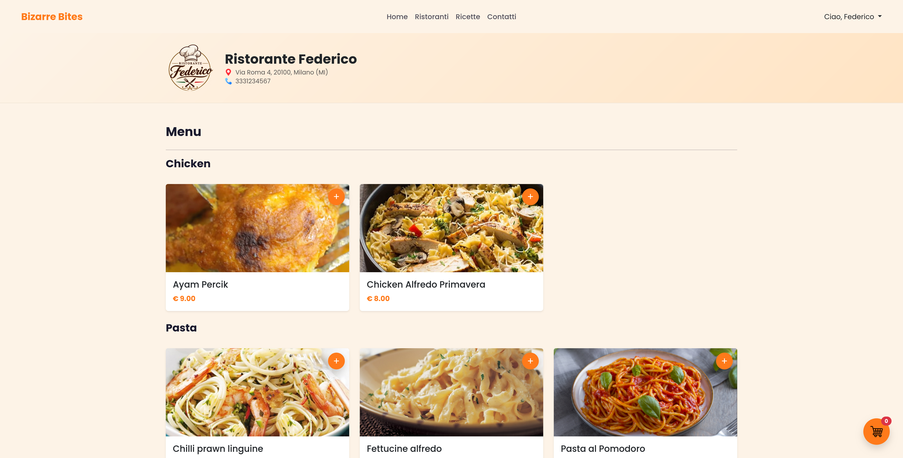

### Ordinare

Il menù viene caricato tramite l'API:

```
GET /ristorante/:id/menu
```

Per effettuare un ordine, il cliente deve aggiungere i piatti che vuole acquistare al carrello. Per fare ciò deve
cliccare l'apposito bottone posizionato in alto a destra di ogni prodotto. Al click si aprirà un modal che permette di
inserire la quantità desiderata e l'evenutale commento.

<p align="center">
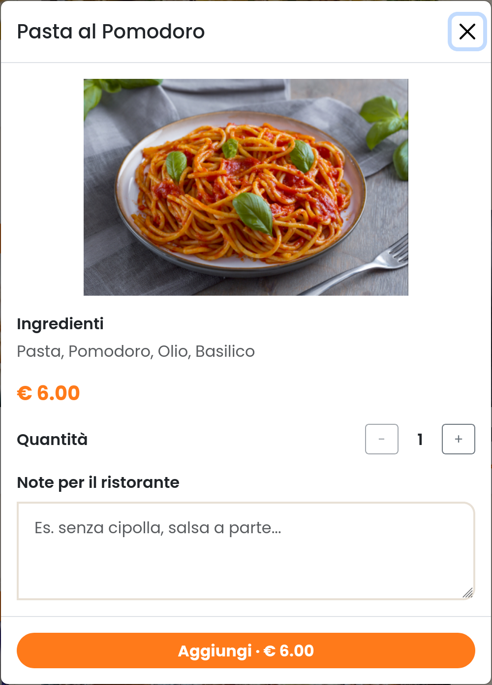
</p>

Il carrello è salvato in `sessionStorage`, la cui chiave è l'id del ristorante. Esso contiene un array contenente tutti
i piatti selezionati con le relative informazioni.

È possibile visualizzare il carrello cliccando l'apposita icona in basso a destra.

Il carrello si mostra nel seguente modo:

<p align="center">
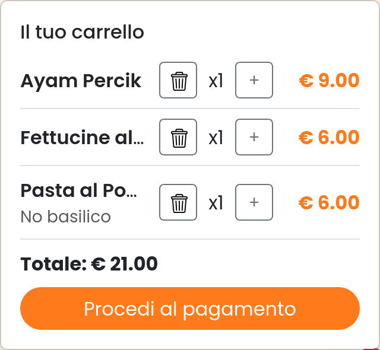
</p>

Da qui è possibile modificare la quantità dei piatti oppure rimuoverli. Con il relativo tasto, si può avanzare la
checkout, `checkout.html`.

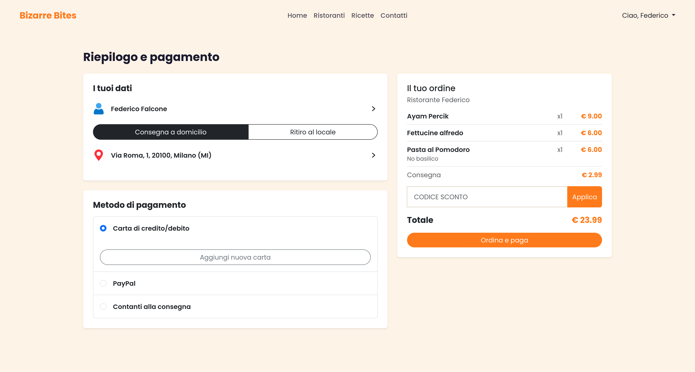

Al caricamento della pagina, si caricano le informazioni del ristorante, tramite l'API:

```
GET /ristorante/:id
```

Da questa pagina si possono modificare tutte le informazioni riguardanti i dati di pagamento e di consegna. Si può
scegliere se ritirare l'ordine al locale oppure riceverlo in consegna. Il costo di consegna è fisso (non implementato
dinamicamente).

Nella sezione superiore, è possibile modificare l'intestatario dell'ordine, scegliere la modalità di ritiro. Se si
seleziona la consegna a domicilio, è possibile modificare l'indirizzo di consegna cliccando su quello attualmente
selezionato. Si aprirà il modal seguente:

<p align="center">
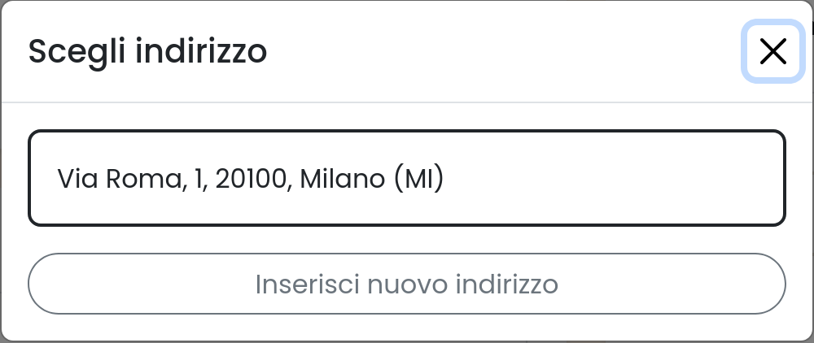
</p>

Da qui è possibile selezionare un indirizzo già salvato nell'account oppure crearne uno nuovo.

<p align="center">
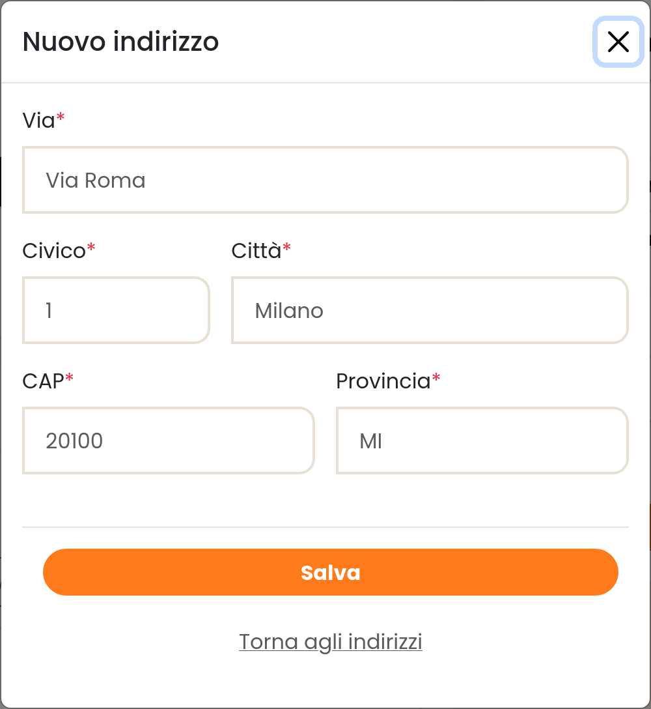
</p>

Il salvataggio del nuovo indirizzo è salvato tramite l'API:

```
POST /user/:id/indirizzi
```

Nella sezione carta di credito in metodo di pagamento vengono caricate le carte salvate per l'utente tramite l'API:

```
GET /user/:id/carte-pagamento
```

Con l'apposito tasto si possono aggiungere nuove carte, si aprirà il modal:

<p align="center">
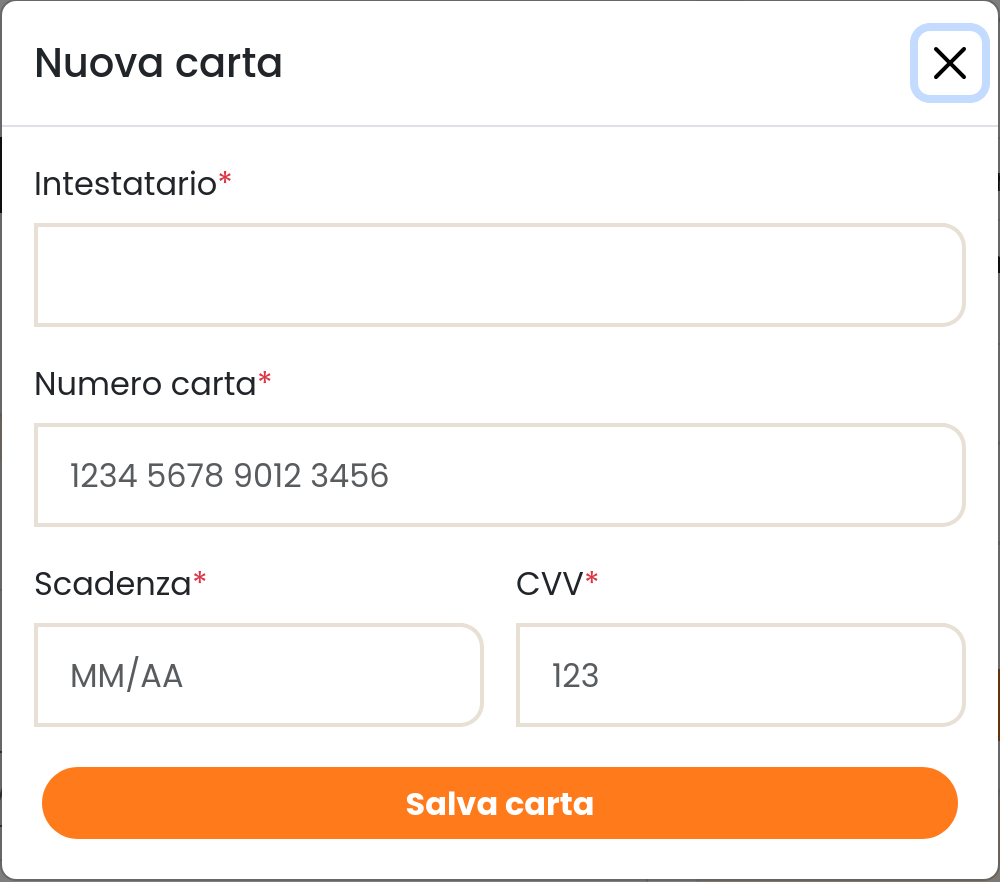
</p>

L'inserimento della nuova carta avviene tramite l'API:

```
POST /user/:id/carte-pagamento
```

Si può eliminare una carta cliccando sull'apposito tasto, l'eliminazione avviene tramite l'API:

```
DELETE /user/:id/carte-pagamento/:id_carta
```

Nella sezione destra è possibile visualizzare il riepilogo dell'ordine. È inoltre possibile inserire un codice sconto
maturato con il programma fedeltà accettato alla registrazione.

Una volta completato l'ordine, l'utente visualizzerà la seguente schermata:

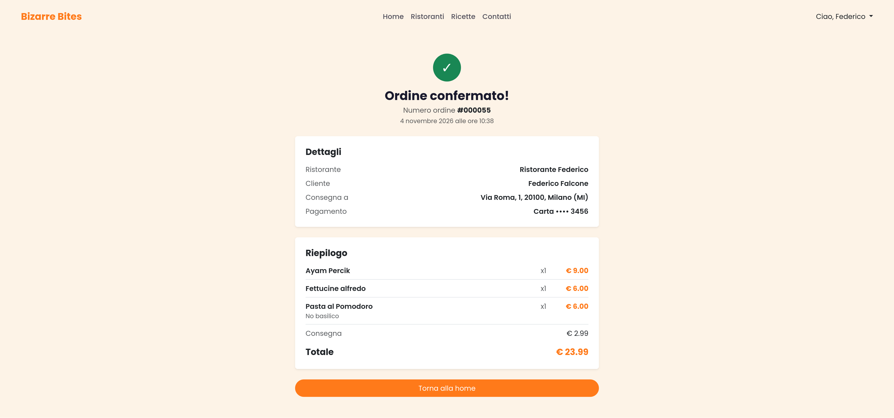

In caso di ritiro al locale, l'utente visualizzerà il tempo stimato di preparazione:

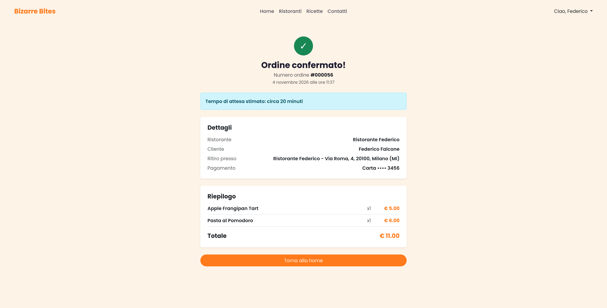

## Gestione ordini

Tramite il menù a tendina nella navbar, l'utente può accedere alla pagina di gestione ordini.

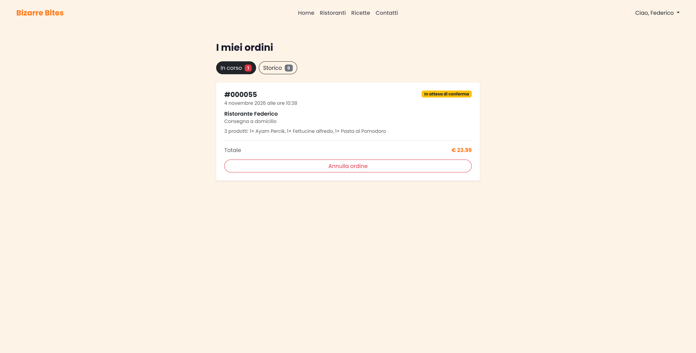

All'apertura della pagina, vengono caricati tutti gli ordini dell'utente tramite l'API:

```
GET /user/:id/ordini
```

Cliccando su un ordine, si viene reindirizzati alla pagina `conferma_ordine.html`.

Quando l'ordine è ancora in fase di conferma, l'utente è ancora in tempo per annullarlo. L'annullamento avviene tramite
l'API:

```
PUT /user/:id/ordini/:numeroOrdine/annulla
```

Quando un ordine è nello stato di "Consegna", l'utente può confermare l'avvenuta consegna cliccando sull'apposito
bottone.

L'ordine viene segnato come consegnato tramite l'API:

```
PUT /user/:id/ordini/:numeroOrdine/stato/ritira
```

## Codici sconto

Ogni 10 prodotti di una determinata categoria acquistati, l'utente, se ha accettato in fase di registrazione, riceverà
un codice sconto del 10% da utilizzare per il prossimo ordine che contiene quella categoria.

Il codice viene generato solo su ordini consegnati. Essi vengono visualizzati nella homepage. Al caricamento della
pagina si ottengono gli sconti tramite l'API:

```
GET /user/:id/offerte
```

Quando poi si eseguirà un ordine, lo si consuma tramite l'API:

```
PUT /user/:id/consumaCodice
```

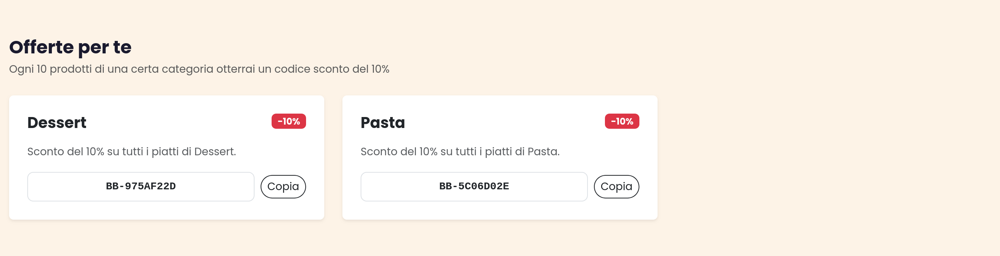